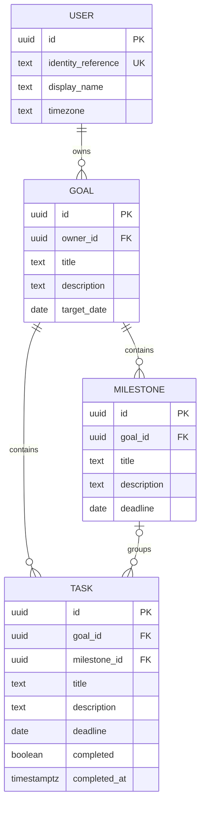

# GoalBuddy core data model

Prepared independently on 2026-11-20. PostgreSQL is recommended, not provisioned or selected as a configured service. The four P1 domain entities follow the existing specification. TypeScript contracts are in [lib/models.ts](../../lib/models.ts); they do not validate runtime input.

## Common record fields

Every entity has `id` (UUID primary key, required, server-generated), `revision` (positive integer, required, initially 1), `createdAt` and `updatedAt` (required UTC `timestamptz`, server-controlled). Recommended SQL names use snake_case; transport/domain types use camelCase. Timestamps serialize as ISO strings. Date-only values serialize as `YYYY-MM-DD` and must be validated independently of TypeScript string aliases. Clients cannot supply ownership, IDs, timestamps, or new revisions.

## Entity fields

| Entity    | Field             | SQL type    | Required / rule                                                                           |
| --------- | ----------------- | ----------- | ----------------------------------------------------------------------------------------- |
| User      | identityReference | text        | Required unique issuer/subject reference established by auth provider; never a credential |
| User      | displayName       | text        | Required, trimmed 1–80 characters                                                         |
| User      | timezone          | text        | Required valid IANA timezone, initial UTC                                                 |
| Goal      | ownerId           | uuid        | Required FK to users.id; immutable                                                        |
| Goal      | title             | text        | Required, trimmed 1–120 characters; duplicate titles allowed                              |
| Goal      | description       | text        | Required stored value, empty string default; input optional, maximum 5,000 characters     |
| Goal      | targetDate        | date        | Optional, null when absent; past dates allowed                                            |
| Milestone | goalId            | uuid        | Required FK to goals.id; immutable                                                        |
| Milestone | title             | text        | Required, trimmed 1–120 characters                                                        |
| Milestone | description       | text        | Empty default, maximum 5,000 characters                                                   |
| Milestone | deadline          | date        | Optional; cannot exceed goal target date when both exist                                  |
| Task      | goalId            | uuid        | Required FK to goals.id; immutable                                                        |
| Task      | milestoneId       | uuid        | Optional; FK must reference a milestone within the same goal                              |
| Task      | title             | text        | Required, trimmed 1–120 characters                                                        |
| Task      | description       | text        | Empty default, maximum 5,000 characters                                                   |
| Task      | deadline          | date        | Optional; cannot exceed available milestone or goal deadlines                             |
| Task      | completed         | boolean     | Required, false initially                                                                 |
| Task      | completedAt       | timestamptz | Null when incomplete; required UTC timestamp when completed                               |

`User` is an application profile. Provider session/account tables are deliberately excluded until provider selection. No plaintext passwords belong here. `Task` uses a discriminated union to express the completion/timestamp invariant. `ProgressSummary` is a derived view, not a fifth persisted entity.

## Recommended database constraints and operations

Use tables `users`, `goals`, `milestones`, `tasks`. Index goals by `(owner_id, created_at, id)`, milestones by `(goal_id, id)`, tasks by `(goal_id, id)` and `(goal_id, milestone_id)`. Stable pagination uses a matching compound cursor. Add unique `(goal_id, id)` on milestones and composite task FK `(goal_id, milestone_id)` to it, so nullable milestone references support direct-goal tasks while cross-goal references fail. Require a separate goal FK for every task. Goal deletion cascades to milestones and tasks; milestone deletion cascades its attached tasks, preserving direct-goal tasks. Account deletion is not an exposed MVP operation; use a restrictive profile ownership FK until its retention and deletion flow is designed.

Use database CHECK constraints for trimmed text lengths, positive revisions, and completion/timestamp consistency. Cross-table deadline invariants need transactions and application validation (or a reviewed database trigger), not a simple row CHECK. Lock the owned goal row before every plan mutation, verify expected revisions, validate related dates, apply changes, increment the affected entity revision and the goal plan revision, and commit together. Reject stale revisions with 409 and invalid parent date edits without partial writes. Set completion time on the first transition; completing an already completed task with a current revision retains that time. Reopening clears it.

All access derives owner from a verified session. Goal reads include `owner_id = session.userId`; child queries join that goal and validate requested parents. Missing and foreign records share a 404. No trusted client owner field and no public data API. Supabase would additionally need owner-scoped RLS on every table, verified JWT/profile mapping, and two-user tests; service-role credentials remain server-only and must not silently bypass application checks.

## Progress and deferred entities

Compute progress as zero for no tasks; otherwise `Math.round(100 * completedTasks / totalTasks)`. A goal is complete only with at least one task and all completed. Account totals count each task once, including tasks assigned to milestones; never average per-goal percentages. Overdue means an incomplete task whose date has ended in the profile timezone. No manual percentage, progress-entry history, or audit-feed feature is justified by P1, so no `ProgressEntry` table is introduced. P2 tags and P3 AI drafts/acceptance receipts retain their Week 02 definitions and are deferred.

Before schema execution, choose and configure the provider and isolated test database, then test ownership, composite FKs, cascade rollback, concurrency, date edits, and completion/reopening. No schema was applied in Week 03.

## Week 04 implementation

PostgreSQL through `pg` was selected, with Auth.js v5 and the GitHub provider for identity. The schema is in [lib/server/schema.ts](../../lib/server/schema.ts) and is applied with `npm run db:migrate`. It implements the four tables, constraints, indexes and cascades described above. Triggers keep `goals.owner_id`, `milestones.goal_id` and `tasks.goal_id` immutable.

`users.identity_reference` stores `github:<account id>`. One justified addition supports authentication: a `sessions` table (`id`, `user_id`, `created_at`, `last_seen_at`, `expires_at`). It makes sessions revocable server-side, with a 24-hour absolute and a 2-hour idle limit. Auth.js stores only the session and user IDs in its encrypted cookie. No provider tokens, emails or passwords are stored.

Timestamps are truncated to milliseconds so that pagination cursors round-trip exactly.

Goal updates and deletions lock the owned goal row, compare the expected revision, check deadline consistency against children, and write inside one transaction.

Tests in `tests/` cover ownership, composite foreign keys, cascade deletion with rollback, stale revisions, deadline edits and the completion constraint. They run on in-memory PGlite. Concurrency under load and the NFR-008 performance target remain unmeasured.
