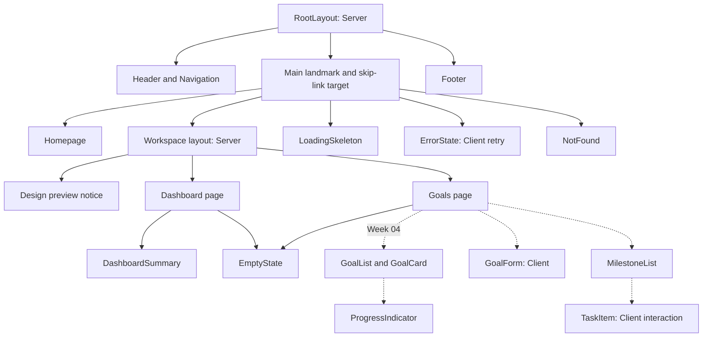

# GoalBuddy Week 03 implementation plan

Date: 2026-11-20. Branch: `feature/w03-team-foundation`. Source: [specification](spec.md). Prepared independently for Ikpemhinoghena Etiuzale under the user's instruction to continue existing work. No meeting, peer approval, or Spec-Kit command execution is claimed.

## Scope and technical context

Week 03 delivers the public application shell, a labeled empty workspace design preview, reusable feedback components, shared domain types, and design documentation. Saved accounts, CRUD, database access, and AI remain future features. Existing issues #3 (T001) and #8 (T006) cover this work; neither is fully complete merely because the foundation exists.

Retain Next.js 16.4.6 App Router, React 19.3.0, strict TypeScript 5.9.3, Tailwind 4.3.3, ESLint 9, Prettier 3, Node.js and npm with the existing lockfile. No service, database, provider SDK, or test library is introduced. Follow the installed Next.js guides for layouts/pages, Server and Client Components, error, loading, and not-found conventions. This version's error boundary receives `retry`, not `reset`.

## Routes and component architecture

| Route                  | Week 03                                        | MVP purpose and prerequisite                           |
| ---------------------- | ---------------------------------------------- | ------------------------------------------------------ |
| `/`                    | Implemented public introduction                | Explain manual planning and optional AI                |
| `/dashboard`           | Labeled static empty-workspace preview         | US5 owned summary after authentication and persistence |
| `/goals`               | Labeled static empty-list preview              | US2 owned list after authentication and persistence    |
| `/login`, `/register`  | Designed, not installed as nonfunctional pages | US1 provider-backed account entry                      |
| `/goals/new`           | Designed                                       | US2 validated creation after #4–#8                     |
| `/goals/[goalId]`      | Designed                                       | US2–US5 goal, milestones, tasks and progress           |
| `/goals/[goalId]/edit` | Designed                                       | US2 revision-aware edits                               |
| `/profile`             | Designed                                       | US1 display name and timezone                          |

Unimplemented URLs return the real not-found UI. Do not display working-looking login or save controls until their behavior exists. `goalId` matches the existing API contract. Dynamic parameters must be awaited when implemented, following the installed guide.

Implemented paths: `app/`, `app/(workspace)/`, `components/layout/`, `components/ui/`, `components/dashboard-summary.tsx`, `lib/models.ts`. Future modules: `lib/server/auth.ts`, `lib/server/goals.ts`, `lib/validation/`, `lib/progress.ts`, `components/goals/`, and `app/api/` route handlers matching the specification. Do not add empty modules in advance.

Server Components compose pages and read authorized data directly through the server-only data-access layer, rather than HTTP requests to the same app. Interactive forms and task controls become small Client Components; the error boundary is currently the only Client Component. Route Handlers will validate requests, establish identity, invoke the same authorized services, and map safe results to the existing HTTP contract. Shared types are contracts, not validation or authorization.

Authentication belongs in the server layer on every protected entry point. Layout redirects improve navigation but never substitute for per-operation ownership checks. Collection queries filter by session user; child lookups join their goal and check both the requested parent and owner. Return identical 404s for absent and foreign records. Never cache private data across users; future private handlers use `Cache-Control: no-store`. Existing cache-component configuration applies only to public content until authenticated cache behavior has explicit tests.

Validation will allowlist fields, reject forged owner IDs, enforce the specification's text/date/timezone limits, JSON content type and 64 KiB body limit. Client feedback mirrors server rules but cannot grant trust. Expected validation/conflict failures preserve form input; unexpected exceptions render safe retry UI without logging personal content. A failed mutation never reports a successful save. Use not-found handling for missing records, associated field errors for validation, and an explicit confirm dialog stating deletion impact.

## Provider decisions: proposed, not installed

Recommend PostgreSQL for foreign keys, transactions, constraints, and revision-based updates. Supabase-managed PostgreSQL is a candidate for reduced operational effort; plain managed PostgreSQL avoids coupling to its auth/RLS APIs but requires more integration. Neither is provisioned. See [data model](data-model.md).

Auth.js offers application-owned integration and session control but requires choosing identity providers, adapters, and operational policies. Clerk offers managed identity UI and workflows with external-service cost and data handling implications. Supabase Auth could reduce integration if Supabase is chosen, but it is an additional alternative, not an established decision. Select one after checking current provider capabilities and credentials; do not install multiple providers speculatively. Vercel is the existing deployment candidate, not a deployed or configured service.

Proposed authentication baseline for the provider review: managed credentials or OIDC; no application plaintext passwords. If password sign-in is selected, require at least 15 characters, accept at least 64, allow paste/password managers, and use provider-managed breached-password checks and salted adaptive hashing. Sessions expire after 24 hours absolute and 2 hours idle; logout revokes server-side. Cookies are HttpOnly, Secure in production, SameSite=Lax, with provider-supported CSRF protection plus same-origin checks on mutations. Proposed throttle: 5 failed attempts per account per 15 minutes and 30 per IP per 15 minutes, with generic errors and 429 retry guidance. Review shared-network and account-lockout implications before enabling. Recovery/email change/deletion remain a separately specified launch prerequisite as Week 02 requires. Course MVP uses test accounts and non-sensitive data.

Optional AI remains P3. Proposed cap: 5 requests per user per hour, timeout within 30 seconds, maximum 20 milestones/100 tasks, explicit payload consent and seven-day pending expiry. No external AI request is made in Week 03.

## Constitution Check before and after design

| Gate                                        | Before             | After design       | Evidence / boundary                                                                 |
| ------------------------------------------- | ------------------ | ------------------ | ----------------------------------------------------------------------------------- |
| I strict TypeScript and limited abstraction | PASS               | PASS               | Typed presentation contracts, no application `any`                                  |
| II App Router boundaries                    | PASS               | PASS               | Installed guides read; Server Components default                                    |
| III accessibility and Tailwind              | PASS               | PASS               | Semantic landmarks, focus, responsive utilities; browser checks recorded separately |
| IV privacy/security                         | PASS               | PASS               | No accounts/data collection; future server boundaries documented                    |
| V verification                              | PASS               | PASS               | Formatting, lint, type/build and route checks required; results in W03 report       |
| VI data consistency                         | PASS               | PASS               | Model invariants and transaction plan; no simulated persistence                     |
| VII optional AI                             | PASS               | PASS               | No dependency on AI in shell or manual MVP                                          |
| VIII honest MVP scope                       | PASS               | PASS               | Preview labels; no saved-feature completion claims                                  |
| issue-before-feature                        | PASS               | PASS               | Existing published #3 and #8 inspected before implementation                        |
| branch from main and reviewed merge         | PROPOSED exception | PROPOSED exception | Branch preserves unmerged Week 02 ancestry; no merge performed                      |

These are design checks, not claims that security or feature acceptance tests have passed. The user explicitly authorized continuation of existing independent work. Week 03 branches from `feature/project-documentation` to preserve its specification and setup rather than the older scaffold on main. Disclose the ancestry exception for reviewer approval before integration. No constitution amendment or peer approval is implied.

## Verification and delivery

Run existing formatting, lint, TypeScript and production build checks; verify real local routes and missing-route handling. Capture actual screenshots if the available browser can do so. Record viewport, keyboard and zoom limits rather than assuming accessibility conformance. No artificial loading delays or error triggers ship.

Week 04 tests should use isolated test users/database, Node's existing test runner for pure validation/progress when practical, database integration tests for rollback/revisions/ownership, and browser tests for the complete manual workflow. Browser tooling remains a justified future selection, not an installed dependency. Include zero tasks, 2/3 = 67%, completion/reopen/delete, cross-user access, deadline boundaries and concurrent writes. NFR-008's 100-goal/1,000-task p95 target remains unmeasured until persistence exists.

No commit, push, PR creation, deployment, or merge occurs in this activity. The user selects the commit message. Review #1 and #2 ancestry before publishing Week 03; main requires a real approving review.
